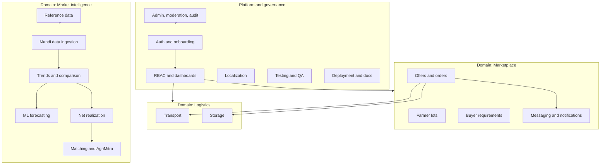
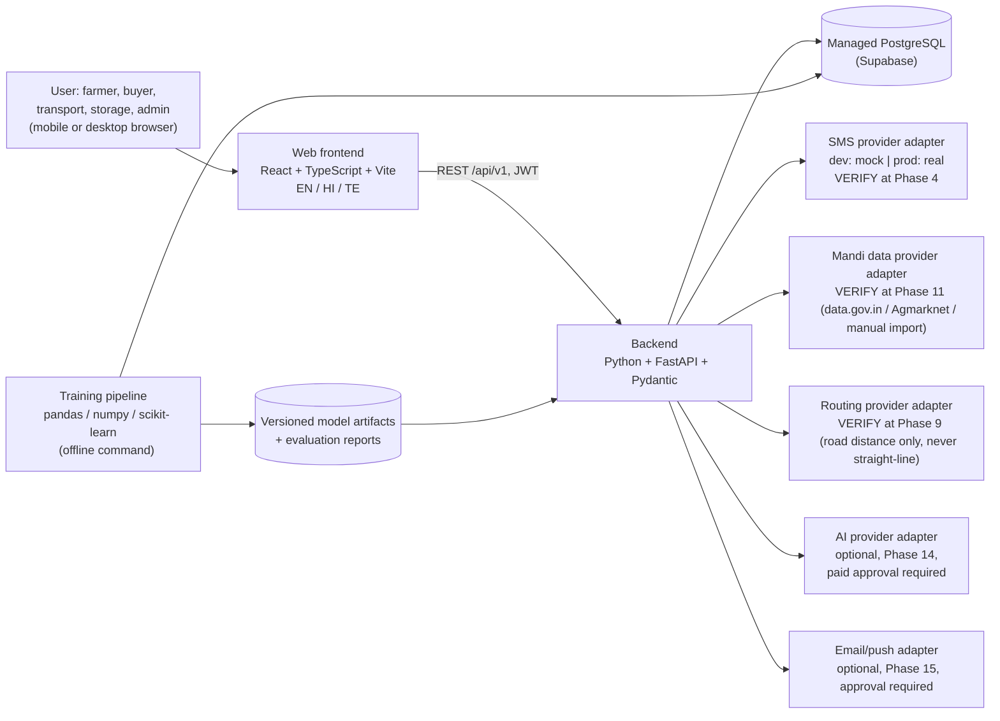
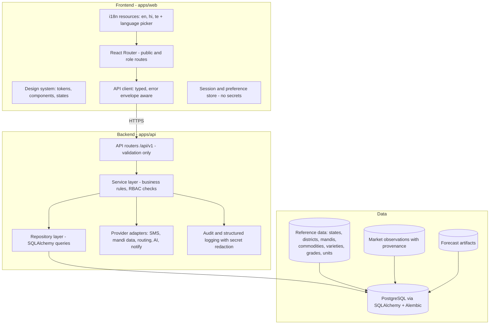
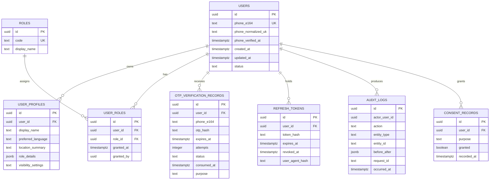
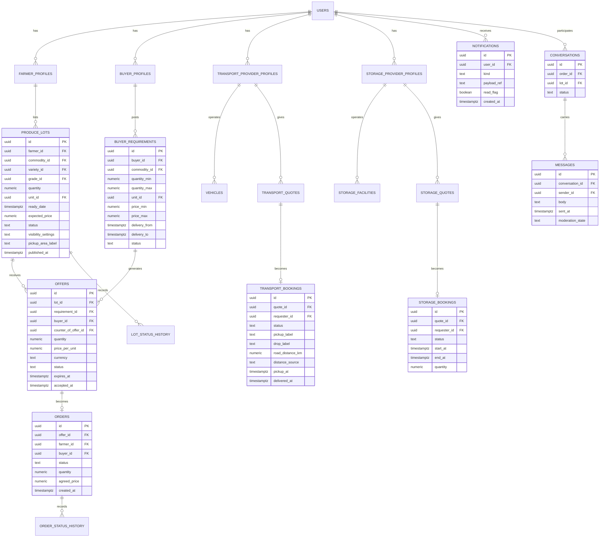
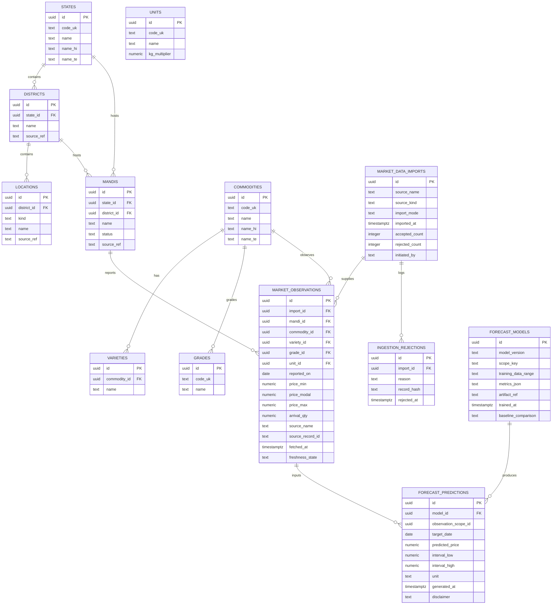

# AgriPredict AI — Phase 0: Discovery and Architecture

| Field | Value |
|---|---|
| Document ID | AAI-P0-DOC-001 |
| Status | **Draft — awaiting founder approval** |
| Date | 2026-10-03 |
| Scope of this phase | Documentation and architecture only. No application features built. |

---

## How to read this document

Every statement carries one of these labels:

- **CONFIRMED** — comes directly from the founder's requirement prompt, or from a decision the founder made during Phase 0 questions.
- **ASSUMPTION** — a safe, reversible engineering default chosen so work can continue. Each one is listed again in §18 with the method to verify it.
- **BLOCKED** — cannot be resolved without external access, credentials, money, or founder approval.

No external API is claimed to be available in this document. Every external service is marked "verify at Phase N".

### Phase 0 decisions recorded from the founder (2026-10-03)

1. **Legacy prototype handling** — keep every existing file untouched as a reference; build the new platform fresh in a new structure beside it. **CONFIRMED**
2. **Real integrations to pursue, in order of importance** — (a) mandi price data, (b) SMS OTP login, (c) road routing/maps. **CONFIRMED**
3. **Geography rollout** — build first for **Andhra Pradesh, Telangana, Karnataka, Maharashtra**; expand to the rest of India later if it is straightforward. **CONFIRMED**
4. **Mandi data source** — the founder reports data.gov.in is *not working*; **Agmarknet is a candidate alternative**. Availability, access method, terms and cost are **UNVERIFIED** and must be proven in Phase 11 before any claim is made. **CONFIRMED as a founder report / UNVERIFIED technically**
5. **`.env.example` secrets** — leave the file as-is for now. Recorded as accepted risk **R-01** (§17). **CONFIRMED**
6. **Individual farmers create their own lots** — an ordinary individual farmer, with no FPO or organisation membership, must be able to register and create/manage their own produce lots. This is a first-class requirement, not an afterthought. **CONFIRMED**

---

## 1. Product vision, problem statement, and problem framing

### 1.1 Vision statement

**A small farmer in India should be able to open AgriPredict AI on a phone, in their own language, and get a clear, honest answer to four questions: when to sell, where to sell, who to sell to, and what they will actually keep after transport, storage and handling costs — with every number traceable to its source.**

### 1.2 Problem statement

Farmers frequently have *fragments* of market information — a price heard at the local mandi, a tip from a trader, a news item. What they lack is an integrated decision-support platform that combines:

1. **WHEN** to sell (timing, using observed and — where validated — forecast data).
2. **WHERE** to sell (comparison across mandis, after costs, not just gross price).
3. **WHO** to sell to (discoverable, explainable matches with buyers, not opaque scores).
4. **Estimated NET realization** after transport, storage, handling and other explicitly entered costs.

Today the calculation is done mentally, with incomplete information, under time pressure, and the platform that should help is either absent, fragmented, or presented as a black box that farmers cannot verify.

### 1.3 Why trust and honesty are product features, not polish

Prices, forecasts and buyer matches that are fabricated, stale, or unexplained destroy the only asset this platform has: trust. Therefore **data provenance, freshness labelling, explainability, and explicit "estimate vs. confirmed" language are core product requirements**, carried into every later phase.

---

## 2. Goals and non-goals

### 2.1 Goals (G)

| ID | Goal | How we know it is met |
|---|---|---|
| G1 | Five complete roles: Farmer, Buyer/Trader, Transport Provider, Storage Provider, Admin | Each role can register, onboard, and use its own dashboard and permissions |
| G2 | Individual farmer can create and manage his/her own produce lots without any organisation | Phase 6 acceptance tests pass for a single individual farmer account |
| G3 | Transparent net-realization calculator with full formula visibility | Every number shows formula, unit, source, and estimate/quote/confirmed labelling |
| G4 | Explainable matching (buyer, mandi, transport, storage) | Every match shows which criteria matched and which did not; no unexplainable score |
| G5 | English, Hindi, Telugu localization across user-facing UI | No hard-coded user-visible strings in the new frontend; locale switch persists |
| G6 | Verified-data-only market intelligence | Every price shows source, reported date, fetch time, freshness; stale/sample data labelled |
| G7 | Security, privacy and audit as defaults | RBAC enforced server-side, OTP never exposed in production, audit trail on privileged actions |
| G8 | Honest forecasting | Model trained, validated chronologically, compared to baselines, with uncertainty — or an honest "unavailable" state |
| G9 | Responsive and accessible on low-end phones | Key screens usable at 360px width, keyboard accessible, labelled states (loading/empty/error/success) |
| G10 | Phased, verifiable delivery | Every phase ships tests, results, limitations, changed files, next step |

### 2.2 Non-goals (NG) — explicitly out of scope

| ID | Non-goal | Rationale |
|---|---|---|
| NG1 | No payment processing, wallet, escrow, or credit | Requires separate approval, licensing, and compliance (Phase 8 boundary) |
| NG2 | No claim of government affiliation or official endorsement | Data sources are third-party; no misuse of government marks |
| NG3 | No guaranteed price, profit, or market-movement claims | Forecasts are estimates with error bars only |
| NG4 | No crop-disease diagnosis or agronomic prescription | AgriMitra gives general educational information, not professional agronomy |
| NG5 | No map/navigation product; no ownership of logistics fulfilment | Routing providers supply road distance; the platform does not operate trucks |
| NG6 | No native mobile apps in this programme | Responsive web first; app shells can be evaluated later |
| NG7 | No scraping of restricted sources, no bypassing access controls | Legal and terms-of-service risk |
| NG8 | No all-India data completeness guarantee at launch | Staged geography: AP, TG, KA, MH first (CONFIRMED) |
| NG9 | No copying of the legacy prototype's demo claims into the new product | Legacy mock buyer lists, "live" tickers and match percentages must not reappear unlabelled |
| NG10 | No social feed, chat rooms, or public comments | Private transaction messaging only |

---

## 3. User personas

Personas are *people*. Roles are *system roles* (§5). One role may cover several personas.

| ID | Persona | Role | Context and needs |
|---|---|---|---|
| P1 | **Lakshmi**, 42, 1.2-acre farmer, Krishna District, Andhra Pradesh | Farmer | Speaks Telugu; sells tomato and chilli. Needs to know *which mandi nets her more* after freight, and needs buyers beyond the local middleman. Uses a low-end Android phone on intermittent data. **Individual — no FPO membership.** |
| P2 | **Ramesh**, 55, 3-acre farmer, Warangal, Telangana | Farmer | Hindi/Telugu. Holds produce 5–10 days waiting for better prices; needs storage and transport quotes and a clear "what will I actually keep" number. |
| P3 | **Sunil**, 34, vegetable buyer/trader, Mumbai | Buyer/Trader | Buys across districts; posts purchase requirements, negotiates via offers, needs reliable supply discovery with grade and quantity filters. |
| P4 | **Car rental operator / truck owner**, Hyderabad | Transport Provider | Lists vehicles and per-trip pricing; wants qualified requests, not tyre-kickers; wants quotes visible as *quotes*, never as confirmed bookings until he accepts. |
| P5 | **Warehouse operator**, Guntur | Storage Provider | Manages capacity by commodity and date; wants no overbooking and clear booking status history. |
| P6 | **Platform administrator** (founder-appointed) | Admin | Moderates listings, imports reference and market data, reviews audit logs. Access granted only through a controlled process. |
| P7 | **AgriMitra user** (any role) | all | Asks questions in plain language; expects honest "data not available" answers instead of guesses. |

**Emphasis (CONFIRMED):** P1 and P2 are *individual farmers*. The product must work for them end-to-end with zero organisational affiliation.

---

## 4. Core user journeys

| ID | Journey | Steps (happy path) | Phase |
|---|---|---|---|
| J1 | Farmer registration → first lot | Enter +91 phone → OTP verify → choose role *Farmer* → complete profile (name, language, location) → create lot (commodity, variety, grade, quantity, unit, ready date, pickup area) → review visibility settings → **publish** | 4, 6 |
| J2 | Farmer sells via negotiation | View received offers → counter or accept → order created from accepted offer → private messaging with buyer → confirm pickup/transport arrangement | 8 |
| J3 | Buyer discovers supply | Register as Buyer → post purchase requirement → browse published lots with filters → send offer → negotiate → accept counter → order appears for both parties | 7, 8 |
| J4 | Transport quoting | Transport provider sets profile, service area, vehicles, pricing model → receives eligible request → submits quote → customer compares quotes → accepts one → booking statuses flow (requested → accepted → picked up → delivered → completed/cancelled) | 9 |
| J5 | Storage booking | Storage provider publishes facility capacity and availability → farmer submits storage request → provider quotes → customer accepts → booking with start/end dates validated against capacity | 10 |
| J6 | Decision support (WHEN / WHERE / WHO / NET) | Pick commodity + quantity → view mandi observations with source & freshness → compare mandis *only when comparable* → open net-realization calculator → enter/see itemized costs with estimate-vs-quote labels → see formula and assumptions → optionally view forecast (only if a validated model exists) | 11, 12, 13 |
| J7 | Admin operations | Controlled admin grant → moderation queue (approve/reject/suspend) → reference-data import → market-data ingestion status → audit log review | 5, 11, 15 |
| J8 | AgriMitra assistance | User asks a question → assistant answers from verified platform data or says data is missing → any consequential action (create lot, send offer, book) requires explicit user confirmation | 14 |

---

## 5. The five roles

| Role | Definition | Primary value delivered |
|---|---|---|
| **Farmer** | An individual who produces and sells agricultural produce. May act alone (default) or later as part of an FPO (optional, not in core scope). | Lists lots, receives offers, gets decision support and net realization. |
| **Buyer / Trader** | An individual or business purchasing produce — wholesalers, retailers, processors, FPOs buying on behalf of members. | Posts requirements, discovers supply, negotiates, orders. |
| **Transport Provider** | An individual or business providing road transport of produce (truck/tempo/tractor operators). | Lists vehicles and pricing, quotes, fulfils bookings. |
| **Storage Provider** | A warehouse, cold storage, or godown operator providing storage and handling. | Lists facilities and capacity, quotes, fulfils bookings. |
| **Admin** | A founder-appointed operator of the platform with privileged moderation and data-management powers. | Moderation, reference/market data management, audit review. **Never self-assigned.** |

**Role model rules (CONFIRMED):**

- A user picks a non-admin role during onboarding; **Admin can never be self-selected or set by editing a client request**.
- One account = one primary role initially (multi-role is an ASSUMPTION deferred; see §18 A-11).
- Role changes are admin-only actions and are written to the audit log.

---

## 6. Confirmed requirement: individual farmers create their own lots

**CONFIRMED by founder, restated for precision:**

- Any individual farmer with a verified phone number can create, edit, publish, pause, close and archive **their own** produce lots.
- **No FPO, cooperative, or organisation membership is required.** Organisation-level aggregation (FPO group lots) is *not* part of the core phases and is treated as a later optional extension; legacy FPO code stays preserved but unused.
- Each lot belongs to exactly one owning farmer account. Ownership is enforced server-side, not by hiding buttons in the UI.
- A farmer can run multiple lots simultaneously, each with independent status and history.
- Visibility of each lot's details (price, exact pickup point, contact) is controlled per lot by the farmer, with a safe default: **exact location and phone number hidden from the public**.

---

## 7. Functional requirements

Mapped to the 18 core modules of the master prompt. "Phase" is where the requirement is implemented and tested.

| Module | Functional requirements (abbreviated) | Phase |
|---|---|---|
| M01 Authentication & onboarding | +91 phone normalization/validation; OTP request/verify/expiry/cooldown/rate-limit/failed-attempt/single-use; dev-only mock SMS; production fails closed without real provider; access tokens; logout/session; role-based onboarding | 4 |
| M02 Role dashboards & permissions | Role-aware dashboard shells; server-side RBAC on every protected route; safe 401/403 responses | 4, 6–10, 15 |
| M03 Farmer profiles & produce lots | Individual farmer profile; lot lifecycle draft→published→paused→closed→archived; lot fields incl. commodity, variety, grade, quantity, unit, ready date, expected price, pickup area, notes; per-lot visibility controls; status history & audit | 6 |
| M04 Buyer profiles & purchase requirements | Buyer business details with privacy controls; requirement lifecycle; commodity/variety/grade/quantity/unit, preferred mandis, price range, delivery window | 7 |
| M05 Offers, negotiation, orders | Offers on eligible lots; accept/reject/counter; defined offer states incl. expiry and withdrawal; conflict prevention on multiple acceptance unless partial quantities are safely supported; orders created only from accepted offers; order status history | 8 |
| M06 Messaging & notifications | Private authenticated messaging between authorized transaction participants; in-app notifications with read/unread and pagination; polling fallback if realtime not configured; no leakage of private data | 8, 15 |
| M07 Transport module | Provider profile, service areas; vehicles (type, capacity, availability, cargo); provider pricing model with units/conditions; quotes; compare and accept/decline; booking statuses; manual distance input until routing provider configured | 9 |
| M08 Storage module | Facility profile, capacity/available capacity, commodity suitability, storage type, handling, availability window, pricing units; requests and quotes; booking lifecycle with capacity and overlap validation; estimate-vs-quote labelling | 10 |
| M09 Reference data | States, districts, cities/towns/villages, mandis, commodities, varieties, grades, units; cascading State→District→Mandi; manual selection default, GPS optional and permission-based; source/import-date traceability; admin import with validation and dedupe; pending rather than fabricated data | 5 |
| M10 Verified mandi data integration | Source identification and terms verification; provider-adapter design; ingestion with full provenance fields; validation, normalization, dedupe, rejected-record logging; freshness display; admin ingestion status; manual import fallback | 11 |
| M11 Price comparison & historical trends | Compatible-slice trends and mandi comparison; source, date range, freshness, unit, missing-data warnings | 12 |
| M12 ML forecasting | Versioned feature pipeline; baseline models first; chronological splits; MAE/RMSE/MAPE where appropriate with limitations explained; model-vs-baseline results retained; forecast metadata incl. horizon, training range, model version, uncertainty; honest refusal when data insufficient | 12 |
| M13 Net-realization calculator | Gross = quantity × identified price; itemized deductions (transport, storage, handling, loading/unloading, other explicit costs); quote/user-entered/estimate labelling; formula, units, sources, timestamp, assumptions shown; comparable-mandi checks; editable scenarios; localized explanations | 13 |
| M14 Explainable matching & AgriMitra | Rule-based compatibility on explicitly defined fields with per-criterion explanation; no unexplainable score; no private data in matching; AgriMitra optional, role-aware, grounded, honest about missing data, confirmation required before consequential actions, minimal data sent to any AI provider | 14 |
| M15 Notifications, admin, moderation, audit | In-app notifications for marketplace events; admin dashboard with users/listings/providers/market-data/system views; approve/reject/suspend/restore with who/when/what audit records; moderation queues and resolution notes; least-data admin views; destructive-action confirmation | 15 |
| M16 Localization | English, Hindi, Telugu resources for all visible UI text; persisted language preference | 2 (base), every phase |
| M17 Testing & QA | pytest backend suite; frontend lint/typecheck/build; integration and E2E journeys; role-isolation tests; security review; test report with exact results | every phase, 16 |
| M18 Deployment & documentation | Hosting comparison, production config, backups/rollback/incident docs, monitoring with approved providers only, verified URL only after successful deployment | 17 |

---

## 8. Non-functional requirements

| ID | Category | Requirement | Target / default |
|---|---|---|---|
| N1 | Security | Server-side authorization on every protected endpoint; least privilege; parameterized ORM queries only; input validation on every request | Fail closed by default |
| N2 | Security | Secrets only in environment variables / secret manager; `.env` gitignored; secret redaction in logs | No secret in any log, doc, screenshot or chat |
| N3 | Security | OTP values hashed at rest, never logged, never returned by production endpoints | Single-use, short expiry |
| N4 | Privacy | Phone numbers, exact pickup locations, and messages visible only to the owner and authorized counterparties/admin per §13 | Default deny |
| N5 | Availability | Health and readiness endpoints; graceful degradation when an external provider fails | UI shows honest unavailable/stale states, never fake fallback data |
| N6 | Performance | Paginated list endpoints; indexed foreign keys and hot filter columns; no unbounded queries | Page size default 20, max 100 |
| N7 | Scalability | Stateless API behind a load balancer; DB on managed Postgres | Horizontal-ready by design |
| N8 | Accessibility | Semantic HTML, keyboard navigation, visible focus, labelled controls, ARIA where needed | WCAG 2.1 AA target (ASSUMPTION A-13) |
| N9 | Responsiveness | All important screens usable at 360px, 768px, 1280px widths | Mobile-first CSS |
| N10 | Localization | All visible UI text from translation resources; locale persisted client-side | EN, HI, TE; fallback to English for missing keys |
| N11 | Data quality | Every market observation carries source, reported date, fetch timestamp; incompatible slices never compared without an explicit normalization method | Provenance is mandatory |
| N12 | Observability | Structured logs with request IDs and secret redaction; error tracking only with approved provider | Correlatable requests |
| N13 | Maintainability | Versioned REST API under `/api/v1`; OpenAPI docs; layered architecture (router → service → repository → model) | Contract-first changes |
| N14 | Testing | Automated tests for every phase's changed behavior; CI runs without production secrets | No claimed pass without a run |
| N15 | Backup / recovery | DB backup and restore procedure documented before production | RPO/RTO defaults in §17 (A-14) |
| N16 | Legal/privacy posture | Indian Digital Personal Data Protection Act 2023 (DPDP) treated as applicable; consent recorded for optional data uses; no personal data in logs | Legal review recommended (not legal advice) — A-15 |

---

## 9. Module map



---

## 10. System architecture

### 10.1 Context (what talks to what)



### 10.2 Containers (inside the system)



---

## 11. Boundaries

| Boundary | What lives there | What must NEVER live there |
|---|---|---|
| **Frontend** | Presentation, routing, form UX, i18n, accessibility, optimistic UI, client-side *duplicate* validation for good errors | Business authority, permission decisions, secrets, direct database access, price/forecast logic that the server does not also enforce |
| **Backend** | Authentication, RBAC, validation, business rules, offer/order state machines, matching, calculation endpoints, audit events, rate limiting | Secret values in code or logs, unvalidated writes, trust in client-supplied role or user id |
| **Database** | Normalized relational model, constraints, indexes, timestamps, foreign keys, provenance columns | Secrets, plaintext OTPs, unbounded JSON blobs used as a substitute for modelling |
| **Authentication** | Phone OTP adapter interface (dev mock / prod provider), OTP hashing and expiry, token issue/refresh/revoke, role assignment guardrails | Self-service admin grant, OTP in responses or logs in production, mock SMS in production |
| **ML** | Offline reproducible training, chronological evaluation, baseline comparison, model versioning, serialized artifacts | Live claims, training on unvalidated data, random time-leaking splits, accuracy numbers not produced by a real run |
| **Integration (adapters)** | One adapter interface per external provider: SMS, mandi data, routing/geocoding, AI, email/push | Provider-specific calls scattered through business logic; assuming a provider exists before verification |
| **Deployment** | Frontend static hosting, backend runtime, managed Postgres, environment configuration, health checks, logs, rollback | Secrets in the repository, production activation without founder approval, paid services without approval |

**Adapter principle:** business code depends on interfaces (e.g. `MarketDataProvider`), never on a concrete vendor. Swapping data.gov.in for Agmarknet, or mock SMS for MSG91, changes one adapter file, not the domain logic.

---

## 12. Initial database entity-relationship design

**Status:** initial design for review (ASSUMPTION until Phase 3 implements and migrates it). All tables get `id` (UUID PK), `created_at`, `updated_at` unless noted. Soft state changes are preferred over hard deletes for anything with audit relevance.

### 12.1 Identity, roles and governance



### 12.2 Marketplace and logistics



### 12.3 Reference data, market observations and forecasting



### 12.4 Modelling notes that must survive into Phase 3

- **Provenance columns are mandatory** on `MARKET_OBSERVATIONS` (`source_name`, `source_record_id`, `reported_on`, `fetched_at`, `freshness_state`) so "live" is never implied by accident.
- **Offers carry a counter-chain** (`counter_of_offer_id`) so negotiation history is reconstructable; state transitions are validated in the service layer and mirrored in an `offer_status_history` table (Phase 8).
- **Estimate vs quote vs confirmed:** cost-bearing rows store a `cost_kind` discriminator (`user_entered`, `estimate`, `provider_quote`, `confirmed`) — this drives the net-realization labelling in Phase 13.
- **Distance honesty:** `road_distance_km` is nullable and always accompanied by `distance_source` (`routing_provider`, `manual_entry`, `unavailable`). Never computed as straight-line.
- **Units:** `UNITS.kg_multiplier` enables explicit unit normalization; comparisons are blocked when units are incompatible.
- **Privacy defaults:** phone, exact pickup coordinates and message bodies are never denormalized into public listing tables.
- **Indexing (planned):** unique + partial indexes on `phone_e164`, `scope_key` slices of observations (`mandi_id, commodity_id, reported_on`), status filters on `PRODUCE_LOTS.status`, `BUYER_REQUIREMENTS.status`, `OFFERS.status`, and `NOTIFICATIONS (user_id, read_flag)`.
- **Deletion posture:** users can request account deletion; personal data is erased or anonymized per retention table in §14 while audit entries retain a pseudonymous actor id.

---

## 13. Role permissions and data visibility rules

### 13.1 Capability matrix

Legend: ✅ allowed · ❌ denied · 🔒 allowed only for own records or with explicit consent · ⚙ admin-only

| Capability | Farmer | Buyer/Trader | Transport | Storage | Admin |
|---|---|---|---|---|---|
| Register / onboard / edit own profile | ✅ | ✅ | ✅ | ✅ | ✅ |
| Assign self the Admin role | ❌ | ❌ | ❌ | ❌ | ⚙ (granted, never self-selected) |
| Create/edit/publish own produce lots | ✅ | ❌ | ❌ | ❌ | ⚙ moderation only |
| Create/edit own purchase requirements | ❌ | ✅ | ❌ | ❌ | ⚙ moderation only |
| Browse published lots / active requirements | 🔒 (authenticated roles) | 🔒 | 🔒 | 🔒 | ✅ |
| Submit an offer | ❌ | ✅ (on eligible lots) | ❌ | ❌ | ❌ |
| Accept / reject / counter an offer | ✅ (own lots) | ✅ (own requirement) | ❌ | ❌ | ❌ |
| View order | 🔒 parties only | 🔒 parties only | 🔒 if booking party | 🔒 if booking party | ✅ least-data view |
| Send/receive private messages | 🔒 conversation participants only | 🔒 | 🔒 | 🔒 | 🔒 only via moderation tool with audit |
| Create vehicles / transport quotes / transport bookings | 🔒 provider own | 🔒 requester own | ✅ | ❌ | ⚙ |
| Create facilities / storage quotes / storage bookings | 🔒 requester own | 🔒 requester own | ❌ | ✅ | ⚙ |
| View market observations and freshness | ✅ | ✅ | ✅ | ✅ | ✅ |
| Import reference data | ❌ | ❌ | ❌ | ❌ | ⚙ |
| Import/run market-data ingestion | ❌ | ❌ | ❌ | ❌ | ⚙ |
| View audit logs | ❌ | ❌ | ❌ | ❌ | ⚙ |
| Approve/reject/suspend/restore accounts and listings | ❌ | ❌ | ❌ | ❌ | ⚙ |
| Use net-realization calculator | ✅ | ✅ | ❌ | ❌ | ✅ |
| Use AgriMitra assistant | ✅ role-aware | ✅ | ✅ | ✅ | ✅ |

### 13.2 Data visibility rules (default deny)

| Data element | Owner | Public / anonymous | Authorized counterparties | Admin | Rule |
|---|---|---|---|---|---|
| Phone number (+91…) | ✅ full | ❌ never | ❌ **not by default** — only after explicit consent action by owner, or when a booking/order exists and policy allows | 🔒 masked, access audited | Never in list endpoints, search, or logs |
| Exact pickup location / GPS | ✅ full | ❌ (area label only) | 🔒 once an offer is accepted or booking confirmed | 🔒 audited | Area/district label is the public granularity |
| Message bodies | ✅ participants | ❌ | 🔒 conversation participants only | 🔒 moderation tool + audit entry | Never surfaced in notifications or search snippets |
| OTP value | system only | ❌ | ❌ | ❌ | Hashed at rest; never returned or logged in production |
| Bank/UPI/payment details | out of scope (NG1) | ❌ | ❌ | ❌ | Not collected in this programme |
| Lot: commodity, quantity, unit, grade, ready date, visibility-approved fields | ✅ | ✅ after publish | ✅ | ✅ | Farmer controls optional fields per lot |
| Lot: expected price | ✅ | 🔒 farmer choice | 🔒 after offer/accepted state | ✅ | Default: shown when farmer opts in |
| Buyer requirement: budget range | ✅ | 🔒 farmer choice (default hidden) | 🔒 after offer exchange | ✅ | Prevents anchoring; explicit toggle |
| Market observations | platform | ✅ with source + freshness | ✅ | ✅ | No private data involved |
| Forecasts | platform | ✅ with disclaimer + model version | ✅ | ✅ | Estimates only, never guarantees |
| Audit logs | platform | ❌ | ❌ | ✅ | Append-only |

---

## 14. Security, privacy, consent, data retention and audit requirements

### 14.1 Security controls (baseline, enforced from Phase 3/4 onward)

- **Authentication:** phone OTP (Phase 4). OTPs hashed with a slow KDF, single-use, 5-minute expiry (ASSUMPTION A-06), resend cooldown 60s, max 5 failed attempts per OTP, per-phone and per-IP rate limits.
- **Sessions:** short-lived access token (15–30 min, ASSUMPTION A-07) + revocable refresh token; logout revokes server-side. Signing secret from environment, rotation procedure documented in Phase 17.
- **Authorization:** every protected route resolves *actor → role → ownership* server-side. Client-sent role/user-id fields are ignored.
- **Production fail-closed:** if no real SMS provider is configured, production refuses OTP issuance; development-only endpoints and mock SMS are unreachable when `ENVIRONMENT=production`.
- **Input validation:** Pydantic schemas on every request body/query; parameterized ORM access only; no raw SQL string concatenation.
- **Output safety:** uniform error envelope (`code`, `message`, `request_id`) — no stack traces, connection strings or provider payloads to clients.
- **Rate limiting:** on OTP request/verify, message send, offer creation, and generic API throttle (limits tuned in Phase 4/8).
- **CORS/hosts:** explicit allow-list per environment; `*` allowed only in local development (the legacy prototype's `allow_origins=["*"]` must not carry over).
- **Secrets:** only `.env` (gitignored) or a hosted secret manager; redaction filter on logs; secret scanning of tracked files in Phase 16.
- **Headers:** HTTPS-only in production, secure cookies, standard security headers, dependency pinning and audit.

### 14.2 Privacy and consent

- Collect the minimum: phone, name, language, coarse location, role details. No Aadhaar, no ID documents unless a later phase explicitly needs them with founder approval.
- **Coarse location by default.** GPS is used only on an explicit user action with a visible purpose statement; precise coordinates are never exposed to other users.
- **Consent records** (`CONSENT_RECORDS`) capture: profile visibility choices, phone-sharing consent for a specific counterparty/booking, optional messaging/notification preferences.
- **Phone sharing:** disclosed only when the owner acts (e.g. taps "share my number") or when a confirmed booking requires it under documented policy; every disclosure writes an audit event.
- Notifications and messages must never contain another user's private phone number or exact location.
- Language preference is profile data, not tracking data. Analytics, if ever added, require founder approval and must be privacy-preserving.
- Indian **DPDP Act 2023** treated as applicable: purpose limitation, consent withdrawal, correction and erasure paths (§14.4). This is an engineering posture, not legal advice — professional review is assumption A-15.

### 14.3 Consent rules by scenario

| Scenario | Consent required | Recorded where |
|---|---|---|
| Publish a lot | Farmer confirms which optional fields are visible | `PRODUCE_LOTS.visibility_settings` + audit |
| Share phone with a counterparty | Explicit tap by the owner, scoped to that conversation/booking | `CONSENT_RECORDS` + audit |
| Precise GPS capture | Explicit action + purpose text, permission can be denied without breaking the flow | device permission + profile |
| Receive email/SMS/push notifications | Opt-in, per channel, revocable | user preferences (Phase 15) |
| AgriMitra sending context to an external AI | Disclosed; minimum necessary context; opt-in before first use | consent + provider log (no secrets) |
| Account deletion / data erasure | User-initiated request, admin-verifiable | deletion request record |

### 14.4 Data retention defaults (ASSUMPTION — confirm before production, A-14)

| Data class | Default retention | Then |
|---|---|---|
| OTP verification records | 24 hours after expiry | hard delete |
| Revoked refresh tokens | 30 days | hard delete |
| Access logs (no PII) | 90 days | aggregate/delete |
| Messages | Until account closure + 90 days | anonymize or delete per policy |
| Notifications | 180 days after read | delete |
| Market observations & imports | Indefinite (business data, provenance value) | archive by year |
| Forecast artifacts & evaluation reports | Indefinite (reproducibility) | archive |
| Audit logs | 24 months minimum | archive, actor pseudonymized on erasure |
| Deleted user profile data | Erasure request honoured within 30 days | keep only legal/audit minimum, pseudonymized |

### 14.5 Audit requirements

- **Who, when, what changed** for: role grants, admin actions, moderation decisions, suspensions/restores, reference and market-data imports, consent changes, phone-number disclosures, lot/requirement status transitions, offer acceptances, order creation, booking acceptances, and forecast publication.
- Audit rows are **append-only** (no update/delete API); each carries `request_id` for correlation with structured logs.
- Audit never stores secrets, OTPs, full message bodies, or full phone numbers (store a masked form or hash).
- Admins can read audit logs; nobody can edit them through the application.

---

## 15. Phased implementation plan

Each phase ends with: implementation · tests + actual results · limitations · changed-file summary · next step, then stops for founder review.

| Phase | Deliverable | Founder input needed | Exit criteria |
|---|---|---|---|
| **0** Discovery & architecture (this doc) | Vision, requirements, ERD, permissions, security posture, risks | Approve this document; decide open items in §20 | Checklist §21 all ticked |
| **1** Project foundation | Monorepo, React+TS+Vite, FastAPI skeleton, health endpoints, lint/type/test commands, CI, PowerShell setup | Confirm Node.js/Python installed (Git for Windows needed first) | Backend tests + frontend build run locally; results reported |
| **2** Design system & localization | Tokens, components, app shell, EN/HI/TE with persistence, landing + dashboard shells, state patterns | Visual direction feedback | Lint/typecheck/build pass; no hard-coded UI text |
| **3** DB & backend foundation | SQLAlchemy + Alembic, Supabase connection, initial models (users/profiles/roles/OTP/audit), layered API, logging, health/readiness, isolated test DB | Enter DB credentials into local `.env` yourself (never chat) | Migrations verified against a non-production DB; tests pass |
| **4** Auth, onboarding, RBAC | OTP flow, mock SMS (dev), fail-closed prod, tokens, role guardrails, onboarding UI in EN/HI/TE | **Decision: SMS provider** (free tier first, e.g. MSG91) — needed for *real* OTP; mock works until then | Full OTP/security test suite passes |
| **5** Reference data | States/districts/locations/mandis/commodities/varieties/grades/units, cascading selects, admin import, provenance | Choose first import file(s) for AP/TG/KA/MH | Cascade + duplicate + invalid-ID tests pass |
| **6** Farmer profile & lots | Individual-farmer profile, dashboard, lot lifecycle, visibility controls, history, tests, EN/HI/TE | — | Ownership/authorization/status-transition tests pass |
| **7** Buyer requirements & marketplace | Buyer profiles, requirements, searchable/filterable marketplace views | — | Visibility and role-access tests pass |
| **8** Offers, orders, messaging | Full negotiation state machine, order lifecycle, private messaging, in-app notifications, rate limits | — | Concurrency, privacy and transition tests pass |
| **9** Transport module | Profiles, vehicles, pricing, quotes, bookings, manual distance | **Decision: routing provider** when real road distance is wanted (OSRM self-host free / commercial paid) | Quote lifecycle + privacy tests pass |
| **10** Storage module | Facilities, capacity, quotes, bookings with capacity/overlap rules | — | Capacity/overlap/authorization tests pass |
| **11** Mandi data integration | Source verification (data.gov.in status, Agmarknet candidate, manual CSV fallback), adapter, ingestion with provenance, admin status, freshness UI | **Verify data source** — founder to confirm which access actually works; approval/credentials only if the source requires them | Ingestion tests pass with labelled fixtures; no "live" claim unless verified |
| **12** Analytics & ML forecasting | Historical trends, mandi comparison, baseline models, validated ML, forecasts with metadata and uncertainty, or honest unavailable state | — | Leakage, serialization, and API tests pass; metrics recorded from a real run |
| **13** Net realization | Calculator with itemized costs, quote/estimate labelling, formula transparency, scenarios, EN/HI/TE explanations | — | Arithmetic, unit, and labelling tests pass |
| **14** Matching & AgriMitra | Explainable rule matching; optional AI assistant with safeguards | **Decision: AI provider + budget** (paid) — optional; non-AI matching ships regardless | Privacy, explainability, confirmation-gate tests pass |
| **15** Notifications, admin, moderation, audit | In-app notifications, admin dashboard, moderation queues, audit views, controlled admin grant | Admin identity/grant method | Admin authorization + audit tests pass |
| **16** E2E, security, QA | Full review, E2E journeys, security checklist, perf/index review, a11y/i18n/responsive checks, test report + bug list | Review prioritized bug list | Honest report incl. skips/failures |
| **17** Deployment, monitoring, handover | Hosting comparison, prod config, backups/rollback/incidents, monitoring, docs, verified URL | **Approval required** before any paid plan, DNS change, or production migration | Deployed URL verified; handover checklist complete |

**Adjustments applied from Phase 0 decisions:** legacy `backend/` and `static/` are preserved and untouched; the new build lives in a new structure (§19, §20-D1). Geography for reference and market data starts with **AP, TG, KA, MH** (CONFIRMED).

---

## 16. External services register (no accounts created in this phase)

Nothing below has been registered, purchased, or verified by me. "How to get it" is the founder's action at the phase shown.

| # | Service | Purpose | Cost expectation | Needed at | How the founder gets it | Status |
|---|---|---|---|---|---|---|
| E1 | **Managed PostgreSQL — Supabase** | Primary database | Free tier likely sufficient to start | Phase 3 | supabase.com → create project → Settings → API → copy URL and keys into local `.env` yourself | A Supabase project URL appears in the legacy `.env.example`; **project ownership/validity UNVERIFIED** (A-01) |
| E2 | **Mandi price data — data.gov.in** | Official daily mandi prices | Free API key | Phase 11 | Register at data.gov.in → request API key for the daily mandi price resource | **Founder reports the site is not working** — re-verify at Phase 11 |
| E3 | **Mandi price data — Agmarknet (agmarknet.gov.in)** | Alternative official market source | Believed free; access method unverified | Phase 11 | Verify whether bulk download, API, or manual CSV export is actually offered; confirm terms before any automated access | **Candidate, UNVERIFIED — do not assume an API exists** |
| E4 | **Manual market-data import** | Fallback when no API works | Free | Phase 11 | Admin uploads a CSV exported from an official source with source name + import date | Designed for, no data imported yet |
| E5 | **SMS OTP provider** (candidates: MSG91, TextLocal, Gupshup, similar) | Real phone verification | Pay-per-SMS, roughly ₹0.10–0.25/OTP in India (UNVERIFIED pricing) | Phase 4 for real OTP (mock works before that) | Create account → complete **TRAI DLT registration** (sender ID + approved templates) → get API key → put key in local `.env` | Not registered. **Only needed when real users register** |
| E6 | **Routing / road distance** | Real road distance for transport quotes and net realization | OSRM self-host = free (needs a server); commercial APIs = paid per call | Phase 9 | Decide: self-host OSRM, or sign up for a paid routing API | Not registered. Manual distance input works until then |
| E7 | **Geocoding** | Coarse location lookup | Nominatim/OSM free with usage policy; commercial paid | Phase 5 (optional) | Respect OSM usage policy (user-agent, rate limits) | Not registered; manual location selection is the default |
| E8 | **AI provider** (OpenAI / Gemini / other) | AgriMitra assistant | Paid per token | Phase 14, optional | Founder approves provider + monthly budget; key goes into server env only | Not registered; non-AI matching ships regardless |
| E9 | **Email / push notifications** | Optional delivery channels | Usually free tier then paid | Phase 15, optional | Only if founder approves | Not registered; in-app notifications are the default |
| E10 | **Hosting** (candidates: Render / Railway / Fly.io for API; Vercel / Netlify / Cloudflare Pages for web) | Production hosting | Free tiers exist with limits — **compare in Phase 17, purchase needs approval** | Phase 17 | Compare, then founder picks and approves | No account created, no purchase made |
| E11 | **Error monitoring / observability** | Production error tracking | Free tier then paid | Phase 17, optional | Founder approval required | Not registered |

**Rule:** no paid service is activated, no account is created on the founder's behalf, and no credential is ever requested in chat. Keys are typed by the founder into the local gitignored `.env`.

---

## 17. Risk register

| ID | Risk | Impact | Likelihood | Mitigation / owner |
|---|---|---|---|---|
| R-01 | **`.env.example` contains real-looking credentials** (Supabase secret key, data.gov.in key, maps keys, personal email). Founder chose "leave as-is" in Phase 0. | High — anyone who obtains the repo gets live credentials | Medium — grows if the repo is pushed/shared | **Accepted for now by founder decision.** Recommended before any `git push` or repo sharing: sanitize the file and rotate the exposed keys. Re-offer at Phase 1 and Phase 16. |
| R-02 | No verifiable mandi data source yet (data.gov.in reported down; Agmarknet unverified) | High — the core value proposition depends on it | High | Phase 11 starts with source verification; manual CSV import is the designed fallback; no "live" claims until proven |
| R-03 | Git for Windows missing → no terminal → tests cannot be run | High — blocks evidence-based phases | Certain until fixed | Founder installs Git (§21 step 0); all phases report actual command results |
| R-04 | Legacy demo claims ("Live" ticker, named corporate buyers, match percentages) leak into the new product | High — violates no-fabrication rule and destroys trust | Medium | NG9; legacy kept only as reference; any reused asset must be re-labelled or rebuilt |
| R-05 | OTP/SMS cost and DLT registration surprises delay real authentication | Medium | Medium | Dev mock keeps all phases moving; DLT guidance documented before Phase 4; approval requested first |
| R-06 | Forecasting attempted on sparse or incompatible data produces misleading numbers | High | Medium | Phase 12 refuses to forecast outside validated scope; baseline comparison mandatory; disclaimer on every prediction |
| R-07 | Straight-line distance presented as road distance | High — financially misleading | Medium | `distance_source` column mandatory; routing adapter; otherwise "unavailable" |
| R-08 | Phone numbers / messages leaked through a list endpoint or notification | Critical — privacy breach | Medium | §13 default-deny table; automated authorization tests per resource; code review checklist in Phase 16 |
| R-09 | Admin role escalation via client-side manipulation | Critical | Medium | Server-side role grant only; tests in Phase 4; no public admin registration |
| R-10 | Scope creep (18 modules) outruns the phased plan | Medium — stalled delivery | High | Strict phase gating; each phase stops for review; new ideas go to a backlog, not into the current phase |
| R-11 | Supabase project in legacy config is not the founder's or has expired | Medium | Medium | Verify target DB identity in Phase 3 without printing credentials; founder confirms project |
| R-12 | Free-tier hosting limits (sleep-on-idle, request timeouts) degrade UX | Low | Medium | Evaluate honestly in Phase 17; disclose limits before any paid plan |
| R-13 | Localization done late becomes expensive | Medium | Medium | i18n infrastructure in Phase 2; "no hard-coded strings" rule in every frontend phase |
| R-14 | Single developer/agent context limits on a very large codebase | Medium | Medium | Small phases, layered structure, documentation updated every phase |
| R-15 | DPDP/legal obligations misunderstood | Medium | Low | Minimal data collection now; professional legal review flagged (A-15) before production |

---

## 18. Assumptions requiring verification

| ID | Assumption | How to verify | When |
|---|---|---|---|
| A-01 | A usable Supabase project exists (URL/key seen in legacy config) | Founder confirms project; connection tested without printing credentials | Phase 3 |
| A-02 | data.gov.in may recover; Agmarknet offers some accessible access method | Live check of both; document terms, frequency, fields, units, key needs | Phase 11 |
| A-03 | AP, TG, KA, MH reference data (districts, mandis) can be obtained from a verifiable source | Source comparison; import with provenance; mark pending where unavailable | Phase 5/11 |
| A-04 | Python ≥3.11 and Node.js ≥18/20 are installed on the founder's machine | `python --version`, `node --version`, `npm --version` in PowerShell | Phase 1 |
| A-05 | OTP expiry 5 min / cooldown 60 s / 5 attempts are right defaults | Tune with real usage data | Phase 4 |
| A-06 | Access token 15–30 min + refresh token is the right session model | Security review | Phase 4 |
| A-07 | App-level RBAC alone is sufficient (no Supabase RLS) for authorization | Security review; consider RLS as defense-in-depth | Phase 3 decision, review Phase 16 |
| A-08 | One account = one primary role is acceptable | Founder/product decision; multi-role later if needed | Phase 4 |
| A-09 | Manual route/distance input is acceptable until a routing provider is approved | Founder decision | Phase 9 |
| A-10 | scikit-learn baselines + one stronger model are sufficient for forecasting | Compare against baselines with real data | Phase 12 |
| A-11 | Responsive web (no native app) meets the audience's needs | Usability check on low-end Android | Phase 16 |
| A-12 | WCAG 2.1 AA is the right accessibility target | Accessibility audit | Phase 16 |
| A-13 | Retention periods in §14.4 are appropriate | Founder/legal confirmation | Before Phase 17 |
| A-14 | RPO 24h / RTO 4h are acceptable for launch | Founder confirmation | Phase 17 |
| A-15 | DPDP Act 2023 is the applicable framework and this posture is adequate | Professional legal review | Before production |
| A-16 | English/Hindi/Telugu translations can be verified by the founder or a reviewer | Translation review; official names preserved where required | Each frontend phase |

---

## 19. Legacy workspace inventory and disposition

**Everything below is preserved. Nothing is deleted, renamed, or modified by Phase 0 except the README status note.**

| Path | What it is | Disposition |
|---|---|---|
| `backend/main.py` + `backend/api/`, `backend/services/`, `backend/models/` | Legacy FastAPI prototype (v2.0.0): locations, mandis, market data, buyers, lots, FPOs, routing, sync | **Preserved, reference only.** Not part of the new build; may be mined for ideas during Phases 3–11, never copied silently |
| `backend/mock_data.py`, `static/js/data/mockData.js` | Fabricated demo commodities/mandis/buyers | **Preserved, marked demo.** Must not be presented as real data in the new product (NG9, R-04) |
| `static/` (HTML/CSS/JS, Chart.js components) | Legacy prototype frontend | Preserved. The new frontend is React + TS + Vite in a separate directory |
| `backend/alembic/` + one migration | Legacy schema migration | Preserved; Phase 3 designs a new migration set rather than assuming this applies |
| `docs/architecture/milestone_0_discovery.md` | **This document** | Active — the Phase 0 deliverable |
| `README.md` | Legacy hackathon README | Prepend a status banner pointing here; original content kept |
| `.env` | Local secrets file | Gitignored, untouched. Founder edits it directly, never pastes contents in chat |
| `.env.example` | Env template — **contains real-looking keys** | Untouched per founder decision; tracked as R-01 |
| `.gitignore`, `pyproject.toml`, `requirements.txt` | Build/config files | Preserved; Phase 1 reviews and updates dependency strategy |
| `.pytest_cache/`, `__pycache__/` | Build artifacts | Ignored by git; deletable at any time (not done in this phase) |

---

## 20. Open decisions for the founder

| ID | Decision | Options | My recommendation |
|---|---|---|---|
| D1 | New-build directory layout | `apps/web` + `apps/api` monorepo vs keeping legacy at root | New `apps/` + `docs/` + `tests/` + `scripts/`; legacy `backend/`, `static/` stay untouched at root — nothing lost, zero collision |
| D2 | Mandi data strategy for Phase 11 | Wait for data.gov.in · try Agmarknet access · start with admin CSV import | **Admin CSV import first** (works immediately, fully provenance-labelled), then automate whichever official source actually responds |
| D3 | SMS provider | MSG91 · TextLocal · Gupshup · other | Decide at Phase 4 with current pricing; nothing needed now |
| D4 | Routing provider | Self-host OSRM · commercial API · manual input only | Manual until Phase 9 review, then self-host OSRM if a server is available |
| D5 | Frontend token/session storage | httpOnly cookie vs bearer token in memory | Decide at Phase 4; httpOnly refresh cookie + short-lived in-memory access token is the safer default |
| D6 | Supabase project | Reuse legacy project · create a new one | **Create a fresh project** for the new build so legacy data/keys never mix — you keep ownership of both |
| D7 | Fate of legacy demo UI | Keep serving it alongside · serve only the new app | Serve only the new app when it exists; legacy stays on disk as reference |
| D8 | `.env.example` sanitization + key rotation | Now · before first `git push` · never | **Before the repo is ever pushed or shared** (R-01) |
| D9 | AI provider and budget for AgriMitra | None · OpenAI · Gemini · other | Defer to Phase 14; ship non-AI matching regardless |
| D10 | Deployment targets | Compare free tiers at Phase 17 | No account or purchase before that comparison and your approval |

---

## 21. Phase 0 acceptance checklist

- [x] **0.1** Product vision, problem statement, goals, non-goals written (§1, §2)
- [x] **0.2** User personas and core journeys defined (§3, §4)
- [x] **0.3** Five roles defined with rules (§5), plus founder's individual-farmer-lot requirement (§6)
- [x] **0.4** Functional requirements (§7) and non-functional requirements (§8)
- [x] **0.5** Module map (§9) and system architecture with Mermaid diagrams (§10)
- [x] **0.6** Frontend/backend/database/auth/ML/integration/deployment boundaries (§11)
- [x] **0.7** Initial ERD covering users, profiles, roles, OTP records, audit logs, lots, requirements, offers, orders, messages, notifications, transport listings, storage listings, bookings, market observations, forecasts, reference data (§12)
- [x] **0.8** Role permissions and data-visibility rules (§13)
- [x] **0.9** Security, privacy, consent, retention and audit requirements (§14)
- [x] **0.10** Phased implementation plan, Phase 0 → Phase 17 (§15)
- [x] **0.11** External services identified, **no accounts created, no paid services used** (§16)
- [x] **0.12** Risk register (§17) and assumptions to verify (§18)
- [x] **0.13** Mermaid diagrams embedded; legacy inventory documented (§10, §19)
- [ ] **Founder approval of this document** → then Phase 1 begins

**Pre-Phase 1 prerequisite for the founder (not blocking approval):** install Git for Windows so tests and builds can actually run:

```powershell
winget install --id Git.Git --exact --source winget
```

Then restart the application so the terminal picks it up.

